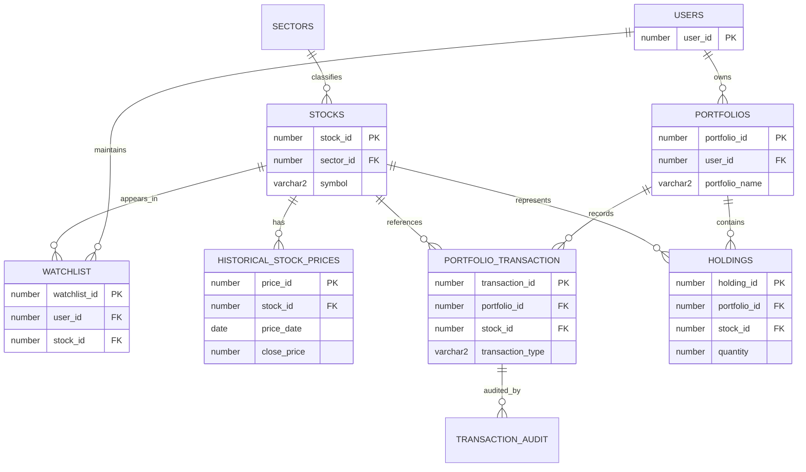

# ER Diagram

Relational notation: `PORTFOLIOS(portfolio_id PK, user_id FK, portfolio_name, description, created_at, updated_at)`; `HOLDINGS(holding_id PK, portfolio_id FK, stock_id FK, quantity, average_cost, cost_basis, updated_at)`; `PORTFOLIO_TRANSACTION(transaction_id PK, portfolio_id FK, stock_id FK, transaction_type, quantity, execution_price, transaction_date, fees, realized_pl)`.
